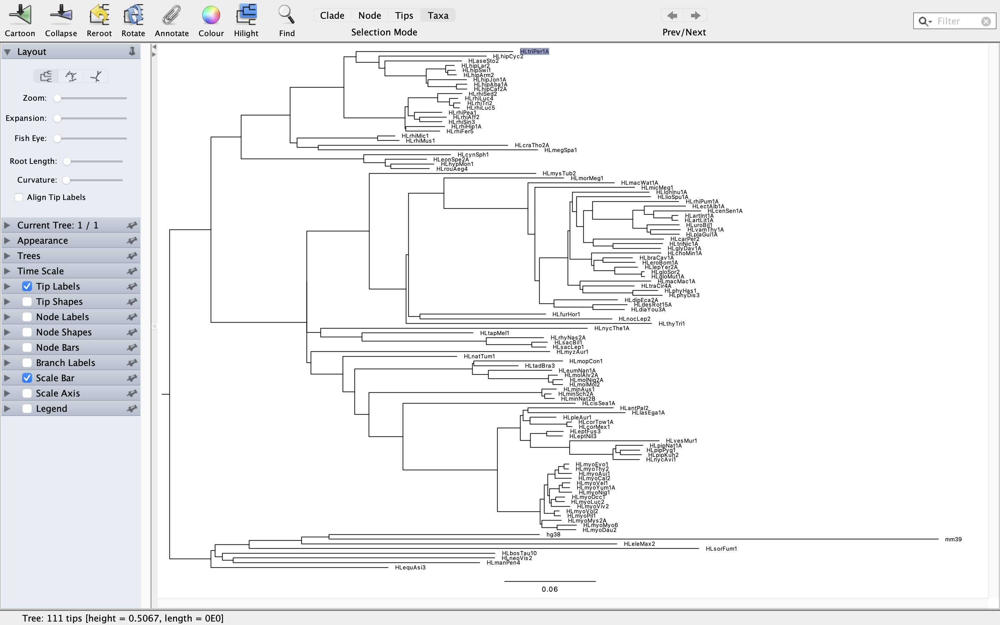

This the tree:
================

.. code-block::
  
  (HLmyoMyo6:0.01282,HLmyoDau2:0.01238,(((((((HLmyoEvo1:0.00304,HLmyoThy2:0.00298)100.00:0.00382,HLmyoAui1:0.00887)100.00:0.00213,HLmyoCal2:0.01080)100.00:0.00497,(((HLmyoVel1:0.00490,HLmyoYum1A:0.00489)100.00:0.00218,HLmyoNig1:0.00839)100.00:0.00620,((HLmyoOcc1:0.00598,HLmyoLuc2:0.00557)100.00:0.00300,HLmyoViv2:0.01235)100.00:0.00109)100.00:0.00136)100.00:0.00225,(HLmyoVol2:0.00338,HLmyoPil1:0.00422)100.00:0.00660)100.00:0.00261,((((HLantPal2:0.05623,HLlasEga1A:0.06396)100.00:0.00325,(HLpleAur1:0.01720,(HLcorTow1A:0.00315,HLcorMex1:0.00337)100.00:0.02422)100.00:0.00457)93.00:0.00185,((HLeptFus3:0.01098,HLeptNil3:0.01048)100.00:0.01074,(HLvesMur1:0.05887,((HLpipNat1A:0.01772,(HLpipPyg1:0.01281,HLpipKuh2:0.01402)100.00:0.00284)100.00:0.00191,HLnycAvi1:0.01736)100.00:0.02849)100.00:0.02600)100.00:0.00659)100.00:0.01502,(((HLminAus1:0.00971,(HLminSch2A:0.00435,HLminNat2B:0.00624)100.00:0.00199)100.00:0.11380,(((HLmopCon1:0.05857,HLtadBra3:0.02927)99.00:0.00095,(HLeumNan1A:0.04168,(HLmolAlv2A:0.00614,(HLmolNig2A:0.00649,HLmolMol2:0.00639)100.00:0.00310)100.00:0.03937)100.00:0.01073)100.00:0.07737,(HLnatTum1:0.07504,(HLmyzAur1:0.15736,(((((((hg38:0.13877,mm39:0.40161)100.00:0.01817,HLeleMax2:0.20794)100.00:0.03453,HLsorFum1:0.29645)100.00:0.02242,(HLbosTau10:0.17974,(HLneoVis2:0.17238,HLmanPen4:0.16256)100.00:0.00710)100.00:0.00483)100.00:0.00278,HLequAsi3:0.11688)100.00:0.05445,((((HLtriPer1A:0.10352,(HLhipCyc2:0.07071,(HLaseSto2:0.05057,((HLhipLar2:0.00572,(HLhipSwi1:0.00522,HLhipArm2:0.00586)100.00:0.00116)100.00:0.01295,(HLhipJon1A:0.02549,(HLhipAba1A:0.00704,HLhipCaf2A:0.00694)100.00:0.01880)100.00:0.00106)100.00:0.02724)100.00:0.00397)100.00:0.01505)100.00:0.00804,(((HLrhiSed2:0.01591,(HLrhiLuc4:0.00566,(HLrhiTri2:0.00431,HLrhiLuc5:0.00385)100.00:0.00296)100.00:0.00759)100.00:0.01955,(HLrhiPea1:0.01795,(HLrhiAff2:0.01753,HLrhiSin3:0.01450)100.00:0.00344)100.00:0.00421)100.00:0.00204,(HLrhiHip1A:0.02551,HLrhiFer5:0.02238)100.00:0.00046)100.00:0.04037)100.00:0.03531,((HLrhiMic1:0.01143,HLrhiMus1:0.01413)100.00:0.05317,(HLcraTho2A:0.12505,HLmegSpa1:0.14460)100.00:0.01406)100.00:0.00440)100.00:0.03227,(HLcynSph1:0.05728,(HLeonSpe2A:0.02717,(HLhypMon1:0.02852,HLrouAeg4:0.02557)100.00:0.00354)100.00:0.01422)100.00:0.08072)100.00:0.02007)100.00:0.06323,((HLmysTub2:0.10979,(((HLmorMeg1:0.07901,(HLmacWat1A:0.05694,(HLmicMeg1:0.06554,((((HLlonInu1A:0.05074,(HLlioSpu1A:0.04872,((HLrhiPum1A:0.05670,((HLectAlb1A:0.02718,(HLcenSen1A:0.03097,(HLartInt1A:0.00400,HLartLit1A:0.00387)100.00:0.01200)100.00:0.00618)100.00:0.00771,(HLuroBil1:0.02118,(HLvamThy1A:0.01974,HLplaGui1A:0.01896)100.00:0.00226)100.00:0.00952)100.00:0.02638)100.00:0.00606,(HLcarPer2:0.04639,(HLtriNic1A:0.03268,HLglyDav1A:0.03142)100.00:0.01297)100.00:0.00649)100.00:0.00446)100.00:0.00286)100.00:0.00158,(HLchoMin1A:0.04582,((HLbraCav1A:0.01941,HLeroBom1A:0.02129)100.00:0.00607,(HLlepYer2A:0.01510,(HLgloSor2:0.00186,HLgloMut1A:0.00194)100.00:0.01754)100.00:0.01391)100.00:0.00160)100.00:0.01415)100.00:0.00125,(HLmacMac1A:0.04649,(HLtraCir4A:0.03385,(HLphyHas1:0.01648,HLphyDis3:0.01943)100.00:0.03281)100.00:0.00181)100.00:0.00803)100.00:0.01881,(HLdipEca2A:0.04183,(HLdesRot15A:0.02249,HLdiaYou3A:0.02073)100.00:0.02561)100.00:0.00966)100.00:0.00298)100.00:0.00460)100.00:0.05535)100.00:0.02342,(HLfurHor1:0.08290,HLnocLep2:0.12660)100.00:0.00747)95.00:0.00167,HLthyTri1:0.16197)100.00:0.02411)100.00:0.04113,(HLnycThe1A:0.17580,(HLtapMel1:0.07340,(HLrhyNas2A:0.03788,(HLsacBil1:0.01040,HLsacLep1:0.00934)100.00:0.03004)100.00:0.08190)100.00:0.02717)100.00:0.00904)84.00:0.00013)100.00:0.00274)100.00:0.02114)100.00:0.00783)100.00:0.00936)100.00:0.02226,HLcisSea1A:0.11361)100.00:0.06240)100.00:0.02814)94.00:0.00110,HLmyoMys2A:0.01270)100.00:0.01001):0.00000;

So, we need to add the branches one by one and then divide by the common ancestor.

1) Reroot the tree correctly
----------------------------

.. code-block:: bash

  ipython

.. code-block:: python

  from Bio import Phylo
  from pathlib import Path
  
  # ============================================================
  # 1. Files
  # ============================================================
  
  desktop = Path.home() / "Desktop"
  
  tree_file = desktop / "Myotis_cactus_neutral_ML.tre"
  rooted_file = desktop / "Myotis_cactus_neutral_ML_rooted.tre"
  
  print("Input :", tree_file)
  print("Output:", rooted_file)
  
  # ============================================================
  # 2. Read the tree
  # ============================================================
  
  tree = Phylo.read(tree_file, "newick")
  
  print("Número total de tips:", len(tree.get_terminals()))
  
  # ============================================================
  # 3. Define the non chiroptera taxa
  # ============================================================
  
  outgroups = [
      "hg38",
      "mm39",
      "HLeleMax2",
      "HLsorFum1",
      "HLbosTau10",
      "HLneoVis2",
      "HLmanPen4",
      "HLequAsi3",
  ]
  
  # ============================================================
  # 4. Verify that everything exists
  # ============================================================
  
  tip_names = {tip.name for tip in tree.get_terminals()}
  
  missing = [x for x in outgroups if x not in tip_names]
  
  if missing:
      raise ValueError(
          f"Faltan esta vaina: {missing}"
      )
  
  print("\nTodos los outgroups presentes.")
  
  # ============================================================
  # 5. Locate the outgroup clade
  # ============================================================
  
  outgroup_clade = tree.common_ancestor(outgroups)
  
  observed_outgroup = {
      tip.name for tip in outgroup_clade.get_terminals()
  }
  
  print("\nTips encontrados dentro del MRCA de los outgroups:")
  for name in sorted(observed_outgroup):
      print(" ", name)
  
  # Tiene que contener EXACTAMENTE los 8
  if observed_outgroup != set(outgroups):
      raise RuntimeError(
          "\nEl MRCA de los outgroups NO contiene exclusivamente "
          "los 8 mamíferos no murciélagos.\n\n"
          f"Esperados: {sorted(outgroups)}\n"
          f"Encontrados: {sorted(observed_outgroup)}"
      )
  
  print("\nOK: los 8 outgroups forman un clado limpio.")
  
  # ============================================================
  # 6. rerroot in the branch
  # ============================================================
  
  tree.root_with_outgroup(outgroup_clade)
  
  # ============================================================
  # 7. corroborate both sides
  # ============================================================
  
  print("\nDespués del reroot:")
  
  for i, clade in enumerate(tree.root.clades, start=1):
      names = [tip.name for tip in clade.get_terminals()]
  
      print(f"\nRama {i}: {len(names)} tips")
      print(names[:20])
  
  # ============================================================
  # 8. save
  # ============================================================
  
  Phylo.write(tree, rooted_file, "newick")
  
  print("\nÁrbol guardado como:")
  print(rooted_file)

